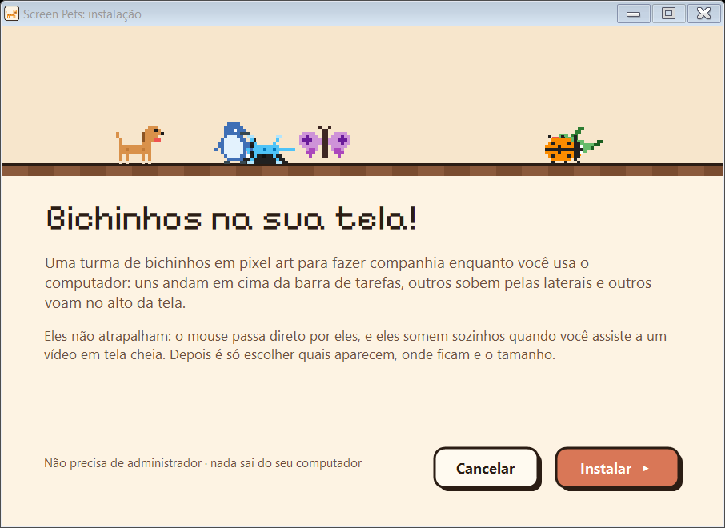
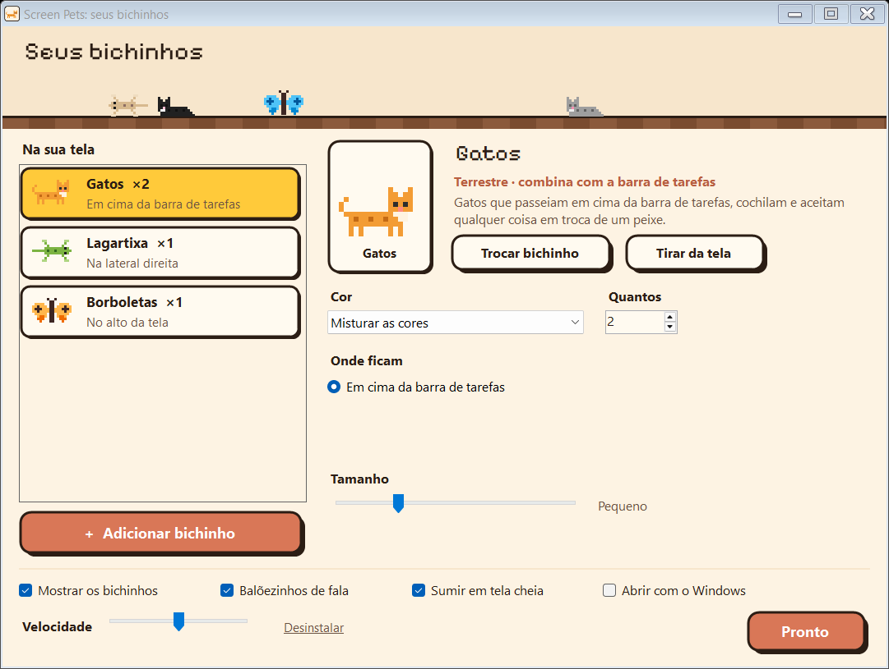

# Screen Pets

**Bichinhos em pixel art que passeiam pelas bordas da sua tela.**

Gatos andando em cima da barra de tarefas, uma lagartixa subindo pela lateral, pássaros voando no alto. Uma turma para fazer companhia enquanto você usa o computador, sem atrapalhar nada. É o irmão do [CmdCrew](https://cmdcrew.serignolli.com) para quem não usa terminal: sem agente de IA e sem configuração técnica, só companhia.

Windows · macOS · Linux · grátis e de código aberto (MIT) · 100% local, sem conta, sem internet e sem telemetria.

[Site](https://screenpets.serignolli.com) · [Baixar para Windows](https://screenpets.serignolli.com/ScreenPets-Setup.exe) · [macOS e Linux](#macos-e-linux) · [Supporters Pack](#supporters-pack)



## Cada um no seu canto

| Tipo | Bichinhos | Onde ficam |
|---|---|---|
| **Terrestres** | gatos, cachorros, pinguins, formigas e coelhos | em cima da barra de tarefas (ou do Dock, ou do painel) |
| **Escaladores** | lagartixa, joaninha, caracol, aranha e besouro | grudados nas laterais ou passeando pelo teto |
| **Voadores** | pássaros, borboletas, abelhas, morcegos e dragão | no alto da tela ou perto das laterais |

Quem anda fica só no chão. Escaladores e voadores dividem o resto: uma aranha pode passear pelo teto e uma borboleta pode voar perto da lateral.

- **Não atrapalham:** o mouse passa direto por eles, as janelas deles não aparecem no Alt+Tab e nunca roubam o foco.
- **Somem em tela cheia:** vídeo, jogo ou apresentação ocupando a tela inteira? Eles saem de cena e voltam depois.
- **Esconder rapidinho:** botão direito no ícone perto do relógio → **Esconder** (para uma reunião, por exemplo) ou **Sair**.
- **Balõezinhos:** de vez em quando um deles comenta alguma coisa; quando dois se cruzam, às vezes param para se cumprimentar.
- **Ligam com o computador:** depois de instalados, voltam sozinhos sempre que o computador ligar (dá para desligar isso).

## Instalar

### Windows

1. Baixe o **[ScreenPets-Setup.exe](https://screenpets.serignolli.com/ScreenPets-Setup.exe)** (cerca de 250 KB).
2. Abra e clique em **Instalar**. Não precisa de administrador.
3. Pronto: os bichinhos aparecem na hora. Escolha quem aparece e onde na tela de configuração.

Ele se instala em `%LOCALAPPDATA%\Programs\ScreenPets`, só para o seu usuário, cria o atalho **Screen Pets** na área de trabalho e no menu Iniciar, liga junto com o Windows e aparece em **Aplicativos instalados**, que é por onde se desinstala (também dá pelo link **Desinstalar** no cantinho da configuração). Quem tinha a versão antiga, com o nome **Screen Crew**, não precisa desinstalar nada: o instalador tira a antiga e leva a configuração.

> O Windows pode mostrar "o Windows protegeu o computador" porque o executável não é assinado. É só clicar em **Mais informações** → **Executar assim mesmo**. Se preferir, compile você mesmo a partir do código (veja [Para quem desenvolve](#para-quem-desenvolve)): é o mesmo programa.

### macOS e Linux

```sh
curl -fsSL https://screenpets.serignolli.com/install.sh | sh
```

Instala sem sudo em `~/Library/Application Support/ScreenPets/app` (macOS) ou `~/.local/share/screenpets` (Linux), com o comando `screenpets` em `~/.local/bin`, liga junto com o computador e abre a configuração no próprio terminal. Rodar o mesmo comando de novo atualiza (a turma configurada fica). Se o site estiver em outro endereço: `curl -fsSL <endereço>/install.sh | SCREENPETS_URL=<endereço> sh`.

| Comando | O que faz |
|---|---|
| `screenpets` | configurar: quem aparece, onde, tamanho, velocidade e abrir junto com o computador |
| `screenpets mostrar` | pôr os bichinhos na tela |
| `screenpets esconder` | tirar os bichinhos da tela |
| `screenpets sair` | fechar o programa (até a próxima vez que o computador ligar) |
| `screenpets desinstalar` | apagar o programa |
| `screenpets versao` · `screenpets ajuda` | versão e ajuda |

- **macOS 11 ou mais novo** (Intel ou Apple). No lugar da barra de tarefas, os terrestres andam em cima do Dock. Eles ficam em todas as mesas (Spaces), menos nas de apps em tela cheia.
- **Linux** com X11 ou XWayland (o normal no Ubuntu, Fedora, Mint e companhia) e um compositor, para a transparência. A área sem os painéis e a detecção de tela cheia vêm do `xprop`.

## Configurar



No Windows, clique no ícone dos bichinhos perto do relógio (se não aparecer, ele fica escondido na setinha `^`) ou abra **Screen Pets** pelo atalho. No macOS e no Linux, digite `screenpets` no terminal. A tela tem três partes:

- **Na sua tela** (esquerda): as turmas de bichinhos. **Adicionar bichinho** abre a escolha, separada em terrestres, escaladores e voadores.
- **A turma escolhida** (direita): trocar o bichinho, a cor (ou misturar as cores), quantos, onde ficam (barra de tarefas, alto da tela, as duas laterais ou só uma) e o tamanho.
- **Embaixo**: mostrar ou esconder todos, balõezinhos de fala, sumir em tela cheia, abrir com o computador e velocidade.

Tudo vale na hora, não tem botão de salvar. O [site](https://screenpets.serignolli.com/#simulador) tem um simulador com a mesma tela, funcionando no navegador com os mesmos desenhos.

## Personagens

Todos estes vêm de graça, cada um com várias cores:

| Tipo | Bichinho | O que fazem |
|---|---|---|
| Terrestre | Gatos | passeiam, cochilam (zzz) e aceitam qualquer coisa em troca de um peixe |
| Terrestre | Cachorros | correm, cavam e trazem o osso |
| Terrestre | Pinguins | escorregam carregando peixes fresquinhos |
| Terrestre | Formigas | levam folhas e açúcar de um lado para o outro |
| Terrestre | Coelhos | saltitam, mexem o nariz e roem uma cenoura |
| Escalador | Lagartixa | gruda na parede e caça mosquitos |
| Escalador | Joaninha | passeia pela lateral e abre as asinhas |
| Escalador | Caracol | sobe a lateral devagar, com a casinha nas costas |
| Escalador | Aranha | sobe e desce pela lateral |
| Escalador | Besouro | sobe a parede e abre as asas |
| Voador | Pássaros | voam e param para cantar (♪) |
| Voador | Borboletas | batem as asas devagar, soltando brilhinhos |
| Voador | Abelhas | zumbem atrás de flores |
| Voador | Morcegos | batem as asas sem parar |
| Voador | Dragão | voa pelo alto e cospe fogo |

Cada personagem é um arquivo JSON em [`personagens/`](personagens), no mesmo formato do CmdCrew: o desenho em texto (cada letra é uma cor da skin, `.` é transparente). Dá para criar o seu: copie um arquivo, troque o `id` e edite os desenhos. Os campos próprios do Screen Pets:

| Campo | O que faz |
|---|---|
| `tipo` | `terrestre`, `escalador` ou `voador`: em que grupo aparece na escolha e onde fica por padrão |
| `ritmo` | velocidade própria (o caracol é `0.35`, o pássaro é `1.4`) |
| `voo` | altura acima do chão, para os voadores |
| `falas` | frases dos balõezinhos |

Os escaladores são desenhados vistos de cima (como se vê uma lagartixa na parede) e o programa gira o desenho para cada lateral. Os voadores nunca giram. Depois de mexer num bichinho, rode `python ferramentas/gerar_site.py` para o site usar o desenho novo.

## Supporters Pack

O Screen Pets é e continua grátis, com todos os bichinhos de hoje. Para quem quiser apoiar o projeto, vem aí o **Supporters Pack**: a turma redesenhada em alta definição, com animações quadro a quadro e mais capricho em cada detalhe, nos mesmos lugares (chão, paredes e céu) e no Windows, no macOS e no Linux.

Ainda está sendo feito e sem data. Quando sair, ele aparece no [site](https://screenpets.serignolli.com/#supporters) e na [página de apoio](https://apoie.serignolli.com/suporte?pack=screenpets-hd). Os desenhos do pack não fazem parte deste repositório.

## Privacidade e o que muda no seu computador

- Tudo roda no seu computador. Não há conta, servidor, telemetria nem acesso à internet.
- **Windows:** os arquivos ficam em `%LOCALAPPDATA%\Programs\ScreenPets`. O instalador cria os atalhos **Screen Pets** (área de trabalho e menu Iniciar), o valor `ScreenPets` em `HKCU\Software\Microsoft\Windows\CurrentVersion\Run` (abrir com o Windows, se ligado) e a entrada de desinstalação em `HKCU\Software\Microsoft\Windows\CurrentVersion\Uninstall\ScreenPets`. Tudo no seu usuário, sem administrador.
- **macOS:** os arquivos ficam em `~/Library/Application Support/ScreenPets`; abrir com o computador é um LaunchAgent em `~/Library/LaunchAgents/com.serignolli.screenpets.plist`.
- **Linux:** os arquivos ficam em `~/.local/share/screenpets`, com o atalho no menu de aplicativos; abrir com o computador é o `~/.config/autostart/screenpets.desktop`.
- Desinstalar tira tudo isso.

## Para quem desenvolve

No Windows não precisa instalar nada: o executável é compilado com o compilador C# que já vem no Windows (.NET Framework 4). A versão de macOS e Linux fica em `go/` (Go + [Ebitengine](https://ebitengine.org), sem cgo) e lê os mesmos `personagens/` e o mesmo formato de `config.json`.

| Comando | O que faz |
|---|---|
| `powershell -File src\build.ps1` | compila `bin\ScreenPets.exe` e `dist\ScreenPets-Setup.exe` (e copia o instalador para `site\`) |
| `scripts\abrir.cmd` | abre usando esta pasta (lê `personagens\` e grava `config.json` aqui) |
| `sh go/empacotar.sh` | compila a versão de macOS e Linux para os 4 alvos: `dist/screenpets-<sistema>-<arq>.tar.gz` (sai de qualquer sistema) e copia os pacotes e o `install.sh` para `site/` |
| `cd site && python -m http.server 8765` | abre o site em http://localhost:8765 (também funciona abrindo `site\index.html` direto) |

Rodando de `bin\` com `personagens\` ao lado, o programa se comporta como instalado; o `ScreenPets-Setup.exe` sozinho (sem a pasta) é o instalador.

### Estrutura

```
src/              código C# (WinForms), o programa do Windows
  Program.cs        comandos e instância única (abrir de novo só traz a configuração para a frente)
  Host.cs           o programa rodando: ícone perto do relógio, palcos e "sumir em tela cheia"
  Stage.cs          uma faixa transparente por borda; a lógica é a do Overlay do CmdCrew num espaço
                    "deitado" que uma matriz leva para o chão, o teto ou as laterais
  ConfigForm.cs     a tela de configuração e a escolha de bichinhos
  SetupForm.cs      o instalador (Installer.cs copia, cria atalhos e registra)
  Data.cs           personagens, configuração (turmas) e desenho em pixel art
  Theme.cs, CrewBanner.cs, Json.cs, Native.cs   tema, faixa animada, JSON e chamadas do Windows
  recursos/         fonte Pixelify Sans e ícone
go/               o programa de macOS e Linux (mesma lógica, em Go): stage.go é o Stage.cs; uma janela
                  transparente cobre a área de trabalho e cada borda é um Stage dentro dela; tui.go é a
                  configuração no terminal
personagens/      os bichinhos (JSON), embutidos no instalador
install.sh        instalador de macOS e Linux
site/             o site (HTML/CSS/JS estático, publicado na Vercel): simulador das bordas em JS
                  (sprites.js espelha o Stage.cs), galeria e download
ferramentas/      scripts Python: gerar o site e o ícone
scripts/          atalho para quem clona o repositório
```

### Comandos úteis

```
bin\ScreenPets.exe folha saida.png                  todos os bichinhos, skins e quadros numa folha
bin\ScreenPets.exe foto 6 saida.png [config.json]   simula 6 segundos e desenha as bordas numa tela de mentira
bin\ScreenPets.exe telas pasta                      a configuração, a escolha e o instalador em PNG (as do site)
bin\ScreenPets.exe setup [pronto|erro]              abre o instalador (as páginas extras só mostram o visual)
go\screenpets.exe foto 6 saida.png [config.json]    o "foto" da versão Go (cd go && go build -o screenpets.exe .)
python ferramentas/gerar_site.py                    atualiza site/dados.js com os bichinhos
python ferramentas/gerar_icone.py                   refaz o ícone a partir do gato
```

### Configuração

A configuração fica em `config.json`: ao lado de `bin\` no Windows e na pasta do programa no macOS e no Linux.

```json
{
  "ativo": true,
  "baloes": true,
  "esconderTelaCheia": true,
  "velocidade": 1,
  "turmas": [
    { "personagem": "gatos", "cor": "*", "lugar": "chao", "quantidade": 2, "tamanho": 2 },
    { "personagem": "lagartixa", "cor": "verde", "lugar": "laterais", "quantidade": 2, "tamanho": 2 }
  ]
}
```

- `lugar`: `chao`, `topo`, `laterais`, `esquerda` ou `direita`. Terrestres só `chao`; escaladores e voadores qualquer um menos `chao` (senão o programa usa o lugar natural deles).
- `cor`: o `id` de uma skin do personagem, ou `*` para misturar todas.
- `tamanho`: de 1 a 5. `velocidade`: multiplicador (a configuração oferece de 0,5 a 2).

### Limitações conhecidas

- Os bichinhos ficam só no monitor principal.
- No Linux, Wayland puro (sem XWayland) não é suportado.

## Créditos

- Os terrestres vieram do [CmdCrew](https://cmdcrew.serignolli.com).
- Fonte [Pixelify Sans](https://fonts.google.com/specimen/Pixelify+Sans) (SIL Open Font License, em `src/recursos/OFL-PixelifySans.txt`).
- Versão de macOS e Linux feita com [Ebitengine](https://ebitengine.org).

Desenvolvido por [Serignolli](https://serignolli.com). Licença [MIT](LICENSE).
